# Shards: Product Design — сценарии и контрактные разрывы

Дата: 2026-10-11. Исследовательский отчёт, не реализация. Исходный визуал Shards сохраняется. Исследованы локальный `shardsmarket/frontend` и read-only исходники `frags/backend`. Production, реальные платежи, сделки и секреты не использовались.

## Вывод для общего плана

Сохранить существующие композицию, изображения, CSS, анимации, карточки, секции пополнений, Duo, каталог и кабинет. Заменить локальные состояния и заглушки реальными серверными контрактами. Коммерчески критичные изменения касаются того, кто покупает, за какую сумму, что подтверждено поставщиком и что остаётся пользователю при ошибке.

Рекомендуемая корзина первого релиза — только серверная после входа, quantity=1, без автоматического guest merge. Пользовательский intent добавления сохраняется в текущей вкладке и возобновляется после входа. Избранное может оставаться локальным. Duo — произвольные нож и перчатки по полной сумме двух цен; Frags bundle API строго трёхпредметный со скидкой 5%, использовать его для Duo нельзя.

Скины оплачиваются только Shards. Steam оплачивается отдельным RUB-платежом и не попадает в корзину и wallet ledger покупки скинов. Для direct Steam минимальный надёжный UX: login + amount RUB + email, затем при необходимости email OTP в существующем Modal, затем платёж с владельцем из серверной сессии. Это дополнительный шаг, но он даёт проверяемое владение историей и не переносит ошибочную verification гостевого email из Frags.

## Метод и границы доказательств

Прочитаны Product Design `index`, `audit`, `user-context`, critical overrides и audit framework. Preflight: сохранённого product-design контекста нет. Нынешние screenshots получены до выводов об интерфейсе; каждый файл сохранён и открыт для проверки. Старые reference-evidence не использованы как доказательство аудита.

IAB недоступен (`Browser is not available: iab`); использован предусмотренный skill fallback — отдельная Chrome-вкладка 22903234. Начальный viewport 1231×792; responsive sample 390×844. Временный viewport сброшен, вкладка закрыта. Это выборочная UX/accessibility проверка, не полная WCAG сертификация и не полная responsive regression.

Первый запуск не состоялся из-за отсутствующего `node_modules`. После разрешения root выполнен `npm ci` из lockfile. Запущен `npm run dev`, exec session 79863, listener PID 10290, 127.0.0.1:5198. Сервер остановлен Ctrl-C, повторный lsof подтвердил отсутствие listener. Все существовавшие relocated tracked файлы frontend побайтно совпадают с прежними root counterparts HEAD; npm/Next не изменили исходники, AGENTS, package, lockfile или tsconfig. Созданы локальные ignored `node_modules`, `.next`, `next-env.d.ts`; последний содержит стандартные references next/image и imports `.next/dev/types/routes.d.ts`, `root-params.d.ts`. npm сообщил 8 dependency advisories; пакеты не обновлялись и security remediation не входила в аудит.

Screenshots — снимки viewport, поэтому соседние части длинных секций могут находиться выше/ниже; выводы относятся только к видимой части. Для Duo используются два соседних состояния. `07-cart-trade-error` отвергнут: DOM уже имел ошибку trade URL, но текст ещё не проявился из-за анимации. Файл перенесён в `rejected-screenshots`, визуальным доказательством ошибки не считается.

## Пройденные шаги и экраны

### 1. Главная — визуальная основа сохранна, коммерческий вход отсутствует

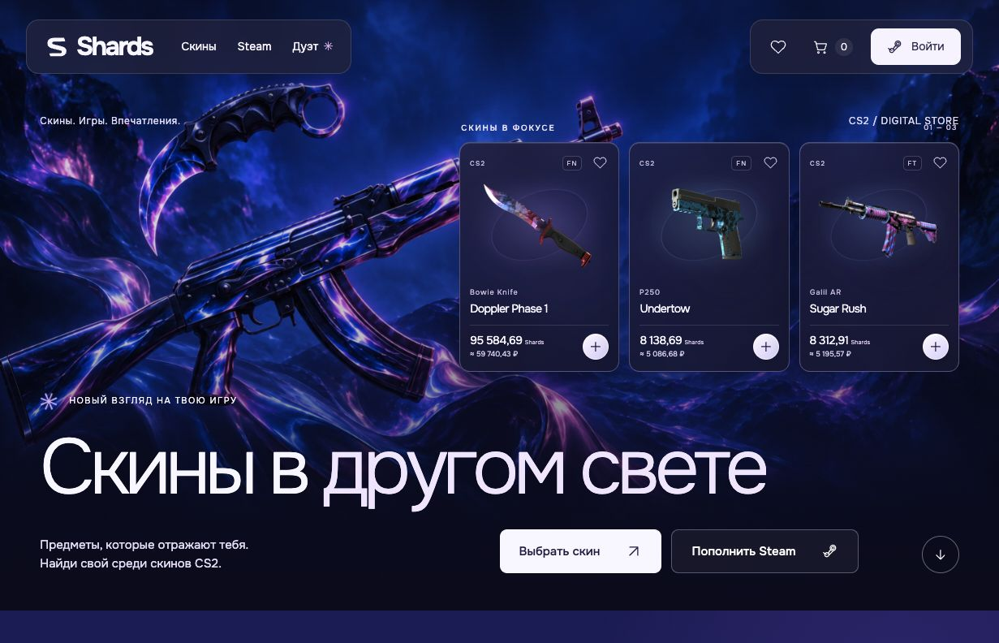

Ясные основные входы: скины, Steam, Duo, корзина, кабинет. Текущий экран пригоден как визуальный baseline. Видимые цены берутся из snapshot, наличие и цены поставщика здесь не проверены. `src/lib/catalog.ts:4–7`: live-mode отдаёт пустой unavailable catalog, иначе JSON snapshot.

### 2. Два пополнения — разделение целей удачное, поля и способы требуют реального контракта

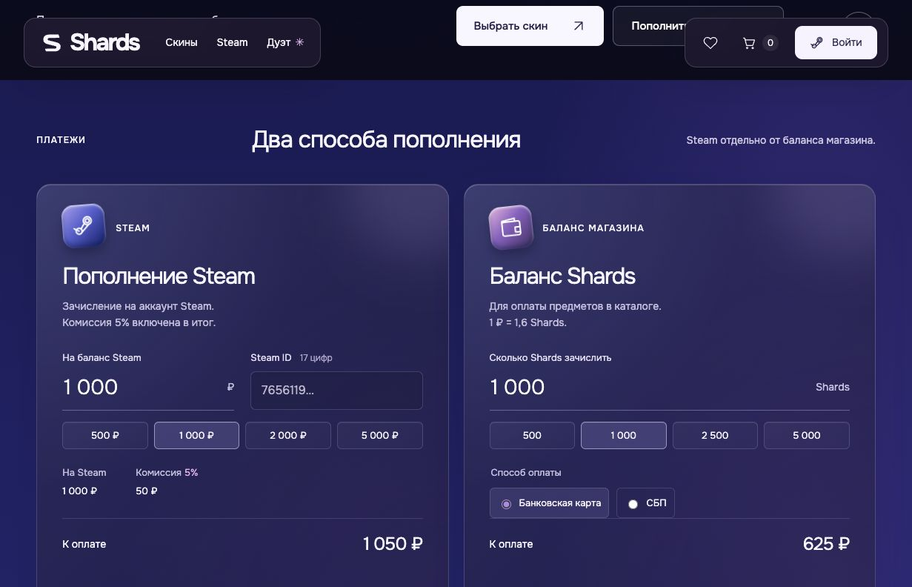

Steam и баланс магазина уже явно разделены. Сохранить два блока и их оформление. Steam просит 17-значный ID, которого Frags direct refill не принимает в качестве контрактного поля: ему нужны `steamLogin`, `email`, целые `amountRub` 50–9433. На стороне Shards показан поиск публичного профиля; найденный профиль не доказывает пригодность login для пополнения. Убрать промежуточный смысл «аккаунт найден», изменить существующее поле на login, добавить email в существующий form layout. Нельзя подразумевать поддержку карты только из-за наличия радио-кнопки: Frags session API не принимает method, интеграция помечает providerPaymentMethod sbp.

### 3. Duo — композиция и простой выбор работают, semantics бюджета требуют фиксации

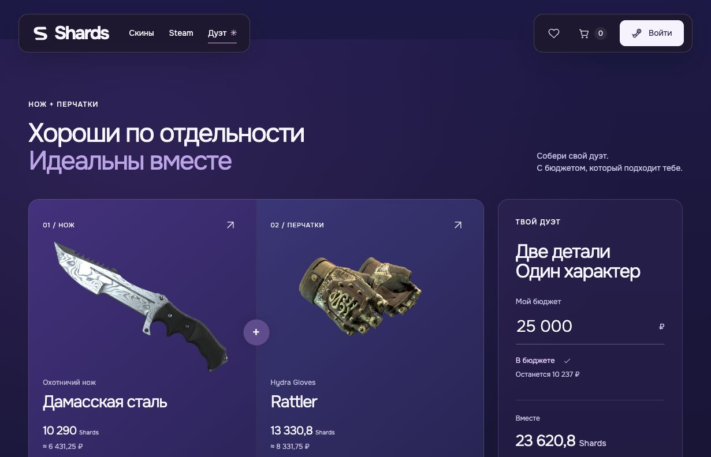

В текущем snapshot выбран самый дешёвый нож и самые дешёвые перчатки: 10 290 + 13 330,8 = 23 620,8 Shards = 14 763 ₽. Бюджет 25 000 ₽, остаток 10 237 ₽. Это сумма без скидки, что соответствует пользовательскому решению. Сейчас выбор ограничен 29 ножами и 2 перчатками snapshot; это не размер будущего каталога.

### 4. Добавление Duo — понятное подтверждение и переход, нельзя перенести optimistic success в production

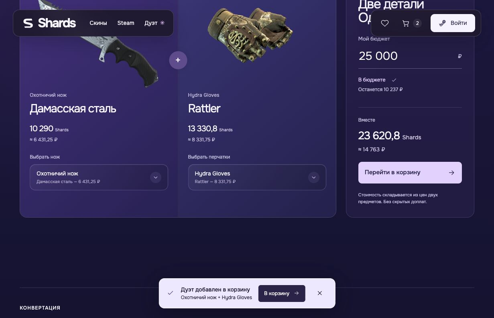

Нажатие добавило две уникальные строки, toast с двумя названиями и ссылкой, CTA переключился на «Перейти в корзину». Существующий визуальный паттерн хорош для сохранения. `shop-provider.tsx:35–37` считает count по incoming products, не по фактически добавленным; при уже имеющемся одном товаре notice может преувеличить результат. Серверная версия должна показывать результат атомарного intent, а не факт нажатия.

### 5. Корзина — позиции и итог читаемы, способы оплаты противоречат новому правилу

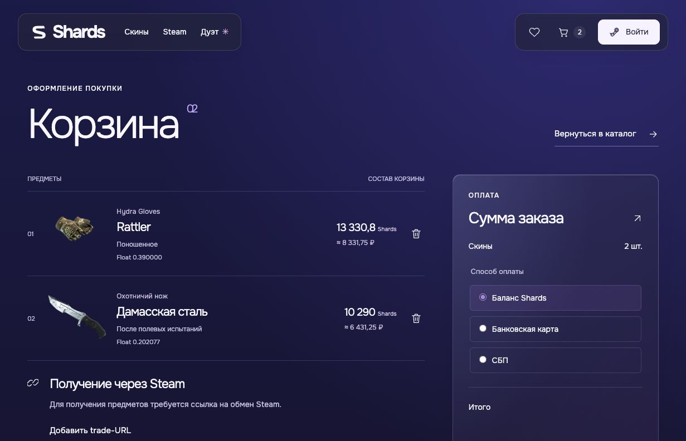

Duo стал двумя обычными позициями, что соответствует отсутствию bundle discount. В списке виден Float, в summary — баланс, карта и СБП. Удалить float и прямые способы оплаты скинов; существующую область оплаты заполнить фактическим балансом, нехваткой и действиями по пополнению в прежних компонентах. Без новых форматов карточек.

### 6. Вход — blocking gap: локальная кнопка выдаётся за вход в кабинет

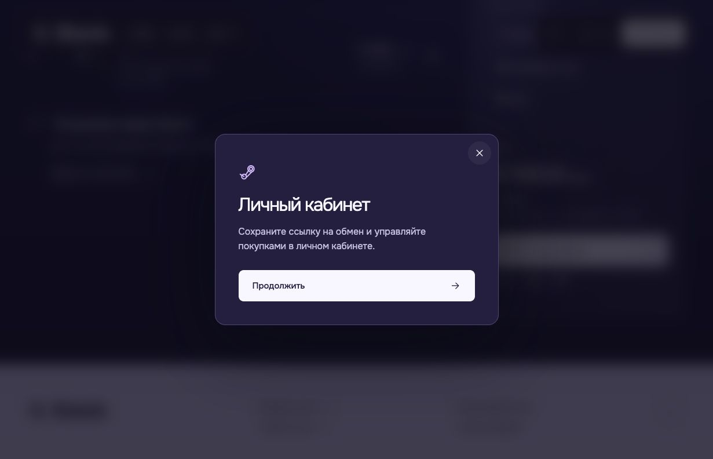

Кнопка «Продолжить» закрыла modal и превратила гостя в локальное loggedIn=true без Steam/email проверки. На /cart контекст сохранился — это хорошее ожидаемое поведение для настоящего auth return, но данный механизм удалить полностью. `shop-provider.tsx:24,41`: `shards:preview-login` не сессия. Steam-иконка не превращает этот шаг в Steam authentication.

После нажатия «Купить скины» с пустым trade URL DOM сообщил необходимость корректного URL; сетевой checkout не вызывался. Непосредственно после этого screenshot ошибки был отвергнут из-за анимации. Ссылка «Добавить trade-URL» открыла кабинет. Возврат после сохранения не предусмотрен в `TradeForm`.

### 7. Кабинет — нужные разделы есть, реальные данные ещё отсутствуют

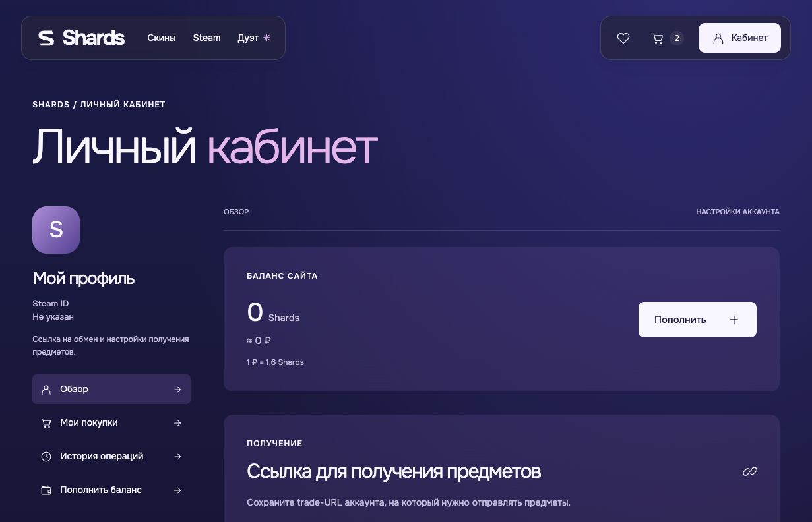

Баланс жёстко 0, Steam ID «Не указан», trade URL хранится в браузере. Сохранить разделы, заменить источник на `/session/me`/wallet/customer contract. Не показывать 0 во время загрузки/ошибки, потому что это другое финансовое состояние.

### 8. История — пока только пустое состояние

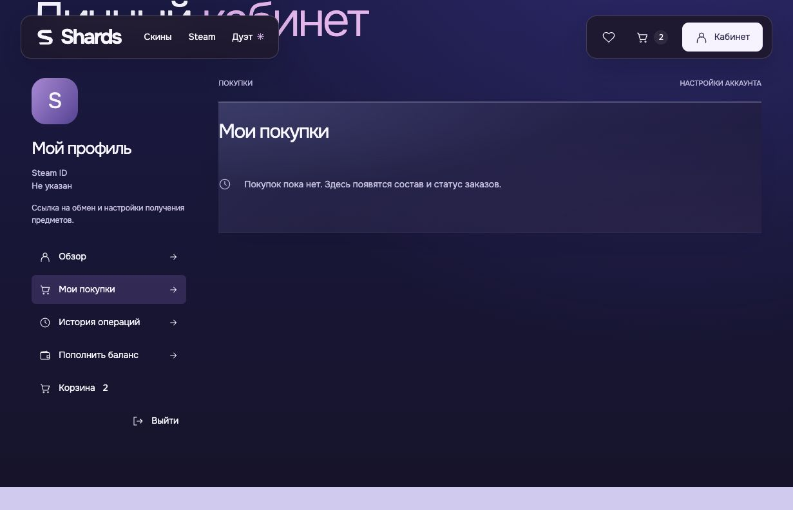

«Мои покупки» и «История операций» не имеют populated/loading/error/partial states. Структура кабинета позволяет наполнить текущую панель, не перестраивая страницу. История заказа должна раскрывать статус каждой строки; «оплачен», «отправлен обмен», «получен», «проверяется» — разные состояния.

### 9. Каталог — действующие фильтры и ссылки, source snapshot

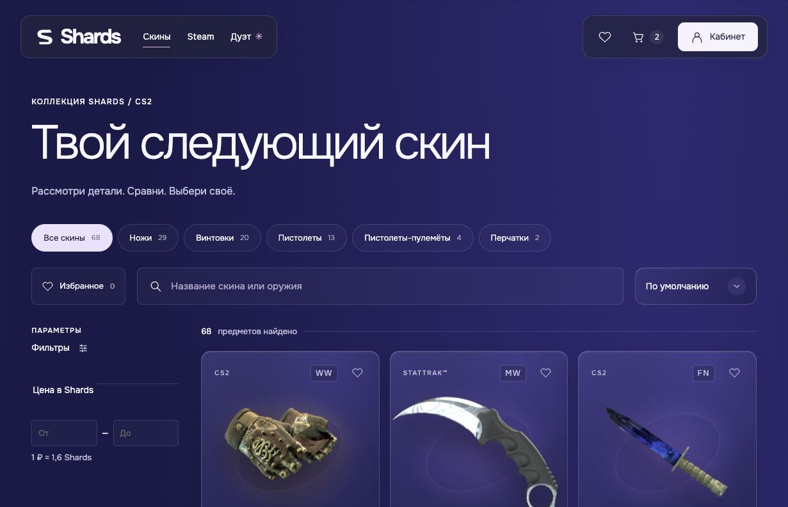

Карточка уже добавленных перчаток ведёт в корзину — duplicate prevention виден также в другом surface. Фильтр цены явно указан в Shards, бюджет Duo — в RUB: не путать их и не менять валюту каталога ради унификации. Поисковая выдача должна стать серверной, с сохранением текущих controls, URL filters и визуала.

### 10. Quick view — working dialog, float и payment copy требуют удаления

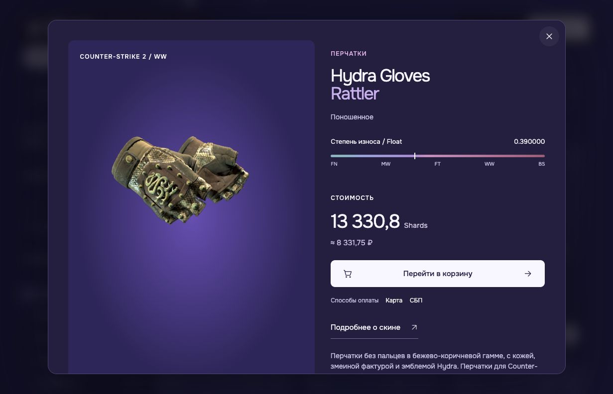

Карточка открыла native dialog с заголовком, фото, ценой, ссылкой в корзину. Escape закрыл dialog, DOM показал focus на исходной кнопке. Сохранить native dialog и focus restoration. Float шкала и карта/СБП здесь тоже подлежат удалению/замене согласно новым правилам.

### 11. Мобильный каталог — выборочная раскладка работает, нужны регрессионные проверки на реальных названиях

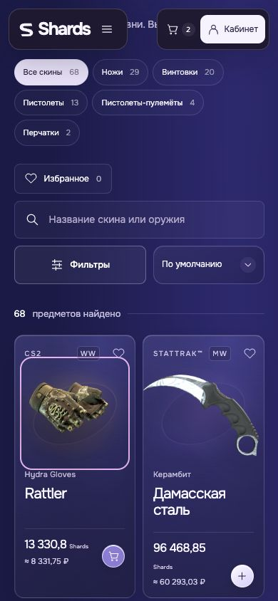

390×844: карточки в две колонки, CTA и изображение доступны, виден focus outline. Длинное «Дамасская сталь» переносится; цена/Shards также может переноситься. Это уже существующий baseline, не основание менять визуальный стиль. При реальном каталоге проверить более длинные названия, большие цены, loading и unavailable.

### 12. Мобильный select — fit и Escape работают, float option всё ещё присутствует

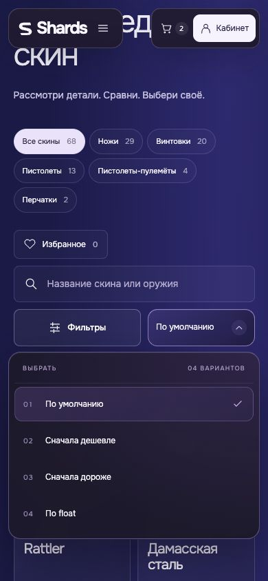

Popup вмещается в ширину 390px, есть четыре option, включая «По float». Escape закрывает. Сохранить компонент и клавиатурное поведение, удалить float option и нормализовать старый `sort=float` URL.

### 13. Мобильная корзина — визуальная основа годится для реальных строк

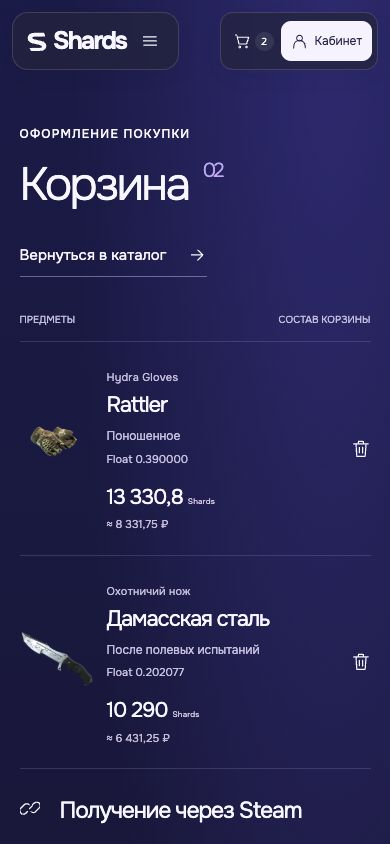

Две строки, цены и удаление читаемы без горизонтального overflow в этом viewport. Нижняя summary за границами данного screenshot и отдельно не проверена на mobile; её результат не следует считать покрытым.

### 14. Duo: изменение бюджета после добавления — бюджет не является платёжным лимитом

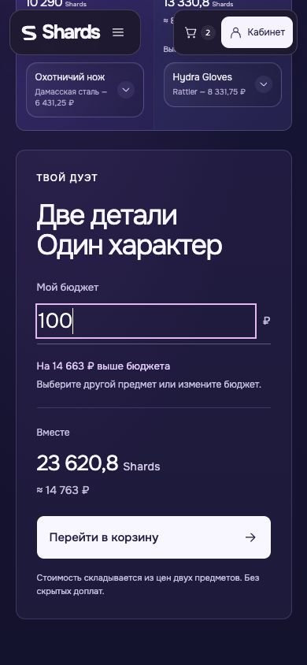

Бюджет изменён на 100 ₽: показано превышение на 14 663 ₽, но «Перейти в корзину» остаётся доступным, поскольку предметы уже добавлены. Это подтверждает: бюджет — preference подбора, не остаток кошелька и не серверный лимит checkout. Сохранить эту distinction в текстах и сценариях. Полный mobile Duo stage/dropdown в этом проходе не покрыт.

## Рекомендуемые сценарии первого релиза

### Корзина и вход

1. Гость свободно смотрит каталог, quick view, Duo, сохраняет избранное.
2. При Add сохраняется tab-bound pending intent `{type, exactSlugs, sourceReturnPath, budgetRubMinor?, createdAt, nonce}`. Не сохранять wallet/session secrets в localStorage. Не объявлять «добавлено» до server success.
3. Существующий Modal предлагает настоящий Steam login для скинов; session restored проверяется API. Frags `/auth/steam/start?returnTo=` имеет allowlist только `/`, `/cart`, `/checkout`, `/balance/top-up`, `/account`, `/account/steam` (`auth.service.ts:34–37`). Произвольный `/catalog/id` или hash Duo сейчас будет заменён на /account. Безопасно вернуть `/cart`, а intent завершить в этой вкладке; расширять allowlist следует явно, не open redirect.
4. После входа revalidate exact products, применить intent один раз, загрузить server cart, показать фактический результат. Если auth отменён/expired — selection и бюджет сохраняются, покупки не совершаются.
5. Single add — set quantity=1, repeated click/retry не увеличивает количество. Duo — атомарно добавить отсутствующие из exact пары, quantity=1, не менять уже существующие unrelated строки. При один-in-cart добавить один, сообщить «Дуэт в корзине» либо «Добавлен 1 предмет, второй уже в корзине». Два-in-cart — только перейти.
6. Expired session во время cart mutation возвращает в тот же intent flow; нельзя переносить pending intent на другого account после explicit logout. Session cache, cart cache и user-specific trade URL очищаются из UI при logout, server cart остаётся у владельца.

Почему auth-only: Frags уже имеет CustomerSessionGuard на всём cart controller, PUT/DELETE CSRF. Guest merge потребовал бы отдельного durable token, merge-result по строкам, idempotency и восстановления частичных ошибок. Дополнительная фрикция до первого Add меньше риска потери/перезаписи корзины при первом релизе. Если позже нужен guest cart, сделать отдельный проект контракта, не отправлять N независимых PUT с последующим unconditional clear local cart.

### Duo и availability

Duo не `bundleId`. Сервер должен валидировать ровно один CS2 knife и один gloves, distinct slugs, qty1. Цена равна сумме серверных цен, discount=0. Frags `BundlesService` (`bundles.service.ts:6–19,42–57,71–96`) фиксирует три predefined названия и 5%; frontend не должен обходить это fabricated bundle id.

Бюджет RUB — персональный предел текущего подбора. Можно сохранить существующее disabled Add при превышении, предлагая изменить бюджет/выбор; это UX preference, не trust boundary. Пустой/invalid input показывает нормальную инструкцию, не платёжную ошибку. Budget=0 валиден как число, но при positive-price pair всегда over-budget. Сумму пары считать один раз из общей Shards minor amount по контрактному курсу; не складывать отдельно округлённые RUB карточек. Пояснить «Останется от бюджета» вместо двусмысленного «Останется», если сохраняется длина/стиль строки.

Недоступность одного выбранного товара не должна silently заменить его cheapest товаром. Сохранить обе карточки, выбранные названия и объяснить, какой товар заменить; Add disabled. Отсутствие всей категории — section state, а не исчезновение `return null`. При transient refresh старые данные можно оставить с признаком обновления, но не выдавать их за текущую quote. При раздельных API PUT возможен добавленный нож без перчаток; поэтому нужен atomic batch/add-duo endpoint или cart transaction — existing `PUT items/:slug` не покрывает это.

### Checkout скинов и недостаточный баланс

Cart load возвращает актуальные цены и availability каждой строки. Пользователь нажимает купить с текущим `acceptedTotalCoinMinor` и stable idempotency key. Если сервер вернул `CHECKOUT_PRICE_CHANGED` — показать обновлённую сумму, явное повторное подтверждение, никакого автоматического повторного debit. При `CHECKOUT_INSUFFICIENT_BALANCE` показать required/available/shortfall, CTA пополнить недостающее в существующей BalanceForm. Whole-Shards минимум 100 и максимум 100000 берутся из backend, а не parseAmount прототипа. Для shortfall с дробной частью — предложить минимальную допустимую целую сумму не меньше нехватки; не пытаться отправить invalid amount.

Пополнение не удаляет корзину и не резервирует цены. Сохранить checkout return intent. После redirect/reload/возврата браузера запросить платёжный статус и wallet, затем заново quote cart. Показывать «Оплата проверяется», если callback ещё не получен; query string success не означает credited. После успешного зачисления предложить вернуться к подтверждению заказа, не выполнять покупку автоматически: цена/остаток могли измениться. Если нехватка выше максимума single top-up — честно объяснить лимит, не silent truncation.

Trade URL: валидировать сервером, связывать с Steam identity, не только regex. Из cart переход в существующую account panel сохраняет returnTo; успешное сохранение возвращает на cart или показывает явную кнопку «Продолжить покупку». Не выдавать empty history/zero balance до session hydration.

### Direct Steam, email и методы платежа

Реальный Frags endpoint: `POST payments/steam-refill/sessions`, integer amount RUB, login 3–64 символа, email, idempotency header. `payments.controller.ts:118–138`. Сейчас он вызывает `findOrCreateEmailUser` без OTP, который устанавливает verified_at (`users.service.ts:180–233`). Не копировать это как подтверждённый email.

Рекомендация: форма login+email+RUB сохраняет прежнюю панель. Guest CTA открывает существующий Modal с OTP и сообщением «Подтвердите почту, чтобы видеть статус пополнения». Использовать существующие `POST auth/email/challenges`, `POST auth/email/challenges/:id/verify` (`email-auth.controller.ts:13–41`). После проверки backend создаёт session и authenticated+CSRF payment endpoint использует session owner, а не произвольный email из body. Для уже verified session пропустить OTP. Для Steam-only session прикреплять email к текущему account после OTP; conflict существующего email owner не должен silently перекидывать оплату на другой account или сливать identities.

Поля login и amount не сбрасываются на неверном/просроченном code, network error, resend, закрытии modal. Resend disabled до серверного resendAvailableAt, paste/autocomplete one-time-code, не озвучивать на каждую цифру. Редактирование email инвалидирует старую challenge. После payment session creation и повторного submit — тот же ключ/operation; after terminal failure новая операция только явным новым действием. Payment pending/processing/history сохраняются через reload.

Tradeoff: OTP добавляет шаг и зависит от фактической доставки почты. Измерять form-start→OTP-sent→verified→payment-created→confirmed, не отключать verification ради конверсии. Более бесшовный guest capability flow возможен, но требует отдельной модели owner/token/history recovery; не минимальный parity-релиз.

Сейчас достоверно обнаружена программная поддержка SBP-пути (`payments.service.ts:900,1104,2031–2034`), но не проведена live acceptance провайдера. Нельзя утверждать, что actual configured environment принимает СБП, и нельзя предлагать карту без provider contract. UI должен получать методы/лимиты/доступность из capabilities либо иметь один явно подтверждённый путь. Скины всегда «Баланс Shards», payment method описывает пополнение, а не покупку.

### Частичное исполнение и истории

Сохранить существующие tabs «Мои покупки», «История операций», «Обзор». Покупки: order header + состав + статус каждой строки + текущее действие. Операции: пополнение сайта/списание/возврат/отдельный Steam платёж, валюта и статус. Поля должны приходить из account-bound APIs.

| Backend state | Понятный смысл пользователю | Поведение |
|---|---|---|
| order held / line pending | Заказ принят, предмет готовится | Не заявлять получение; обновлять статус |
| trade_offer_sent | Обмен отправлен | Действие открыть Steam только по доверенной ссылке |
| trade_protection | Обмен на проверке Steam | Не показывать refund/доставлено до terminal state |
| delivered | Предмет получен | Показать завершение этой строки |
| partially_fulfilled | Часть предметов получена | Явно перечислить завершённые, ожидающие, failed |
| failed | Не удалось выдать предмет | Сумма возврата только по ledger, не по обещанию UI |
| needs_review/manual_review | Требуется проверка | ID заказа, поддержка, последнее обновление; без «попробуйте купить снова» |
| payment checkout_pending | Ожидаем оплату/подтверждение | Resume только по действующей session |
| paid | Оплата подтверждена | Для Steam не автоматически equate с delivery без provider terminal evidence |

Frags order DTO поддерживает order statuses и fulfillmentStage по каждой строке (`orders.service.ts:12–35,84–105`); checkout return `held` не delivery. В Steam history есть mapping payment paid→fulfilled/delivered; это требует отдельной проверки, что источник paid имеет смысл terminal refill, а не только списания. Финансовый state и delivery state должны оставаться отдельно. Нельзя retry весь частично исполненный Duo: это купит второй экземпляр уже полученного ножа.

## API gaps, которые нужно закрыть до подключения визуала

| Приоритет | Gap и доказательство | Минимальное изменение контракта |
|---|---|---|
| P0 | Local auth/trade/cart (`shop-provider.tsx:20–44`) | Server session, CSRF, wallet, account-bound cart/trade URL |
| P0 | Auth-only cart есть, atomic arbitrary pair нет (`cart.controller.ts:45–115`) | Atomic add exact knife+gloves, result items added/already present; qty1 and idempotent replay |
| P0 | Cart item DTO не имеет availability, `loadCart` Promise.all getBySlug может завалить весь cart при NotFound (`cart.service.ts:219–243`) | Tombstone/snapshot unavailable item remains visible/removable, explicit unavailable lines; no silent prune |
| P0 | Цена/баланс errors уже typed (`checkout.service.ts:99–159`) | Map codes на exact UI recovery, accepted quote и idempotency persistence |
| P0 | Steam guest email автоматически verified | OTP owner proof + authenticated steam payment; не доверять request email как identity |
| P0 | Прототипный SteamID + карта/СБП | Server capabilities, login+email, integer limits, independent payment/delivery status |
| P0 | История отсутствует в UI, partial backend states есть | Orders/payments/wallet/trades adapters; map line state and ledger refund |
| P1 | GET bundles поддерживает snapshot unavailable, individual cart нет | Не портировать bundle discount; заимствовать идею durable unavailable snapshot для regular items |
| P1 | Произвольный auth return не проходит allowlist | Controlled cart return + tab intent; при необходимости explicit safe routes |
| P1 | Snapshot IDs, client filter/count, static export | Live catalog adapter, paginated listing/counts, stable slugs, error/retry within existing sections |

## Полное удаление float

Удалить product-domain float, не языковой тип GLSL `float`, `Float32Array` и `parseFloat` визуальной анимации.

- `src/components/products.tsx:17`: full detail и quick view float-block, track, labels.
- `src/components/cart-view.tsx:19`: Float строки.
- `src/components/skin-compare.tsx:46`: «В твоём фокусе» Float spec.
- `src/components/catalog-view.tsx:18`: option `sort=float`.
- `src/lib/filters.ts:27`: float comparator; нормализовать старые URL параметры.
- `src/lib/types.ts:4`: product.float; catalog data adapters/serializers не возвращают поле в публичный Shards DTO.
- `src/data/catalog.json`: значения float всех snapshot items; после live adapter snapshot не fallback коммерческих цен.
- `src/app/globals.css`: `.float-block`, `.float-track`, `.float-labels`, responsive `.quick-detail .detail-content .float-block` — только orphan declarations после удаления поверхностей. Остальную CSS/анимацию не трогать.
- `tests/catalog-contract.test.ts:14,34`, `tests/filters.test.ts:5`: assertions/fixtures float заменить тестом отсутствия public-domain float и legacy sort fallback.

Condition FN/MW/FT/WW/BS остаётся отдельной категорией wear; пользователь удалил numeric float, не названия состояния. Не удалять condition из имени market item, так как это влияет на реальную identity/стоимость.

## Доступность, loading и errors без изменения визуальной системы

Подтверждено в данном проходе: native modal, Escape close и возврат focus на trigger; select Escape; видимый focus ring; aria-live toast; labelled inputs; keyboard handlers select и reduced-motion есть в исходниках. Это не доказывает весь keyboard order или screen reader experience.

Сохранить существующие classes и компоненты. Новые loading/error/status размещать в текущих form-message/receipt/account-panel areas. Buttons: loading label + disabled на pending для защиты от двойной операции, `aria-busy` на form/region; повтор после unknown network outcome сначала status/replay. Form errors связать `aria-describedby` с конкретным полем и добавить aria-invalid; после submit focus на invalid field, глобальные recoverable errors в status/alert. Critical payment status не должен ждать долгой reveal-анимации: screenshot 07 подтвердил промежуток, когда DOM error существует, но ещё не виден. Можно исключить задержку у transactional live-message, сохранив общие анимации дизайна.

Loading balance не показывать как 0, loading history не показывать как «покупок пока нет», unavailable catalog не смешивать с zero results. Сейчас `catalog-view.tsx:18` при unavailable рекомендует «сбросить фильтры», что не восстанавливает upstream; нужен retry в том же EmptyState. Уведомление Add не исчезает автоматически — это полезно для пользователей, которым нужно время; close и cart link сохранить. Для partial add текст должен отражать серверный результат. Не перемещать focus в toast.

Не измерены: точный contrast ratio, target bounding sizes, 200%/400% zoom, VoiceOver speech, Safari, touch keyboard, reduced-motion runtime, slow network. По screenshots нельзя утверждать, что мелкий muted текст соответствует WCAG. Нужны измерения в финальной QA, не новое оформление по субъективному впечатлению.

## Responsive и функциональная regression matrix для реализации

| Размер/режим | Обязательные surfaces | Проверки |
|---|---|---|
| 360×800, 390×844 | Home topups, catalog, cart, Duo, quick view, OTP | Нет overflow; email/login не обрезаются; focus visible; keyboard не закрывает CTA; popup в viewport |
| 520×900, 800×1024 | Boundary layouts | Columns/collapsed nav/filter menu; одинаковые основные CTA aligned; не выпадают изображения |
| 1024×768, 1231×792, 1440×900 | Все основные страницы | Frozen composition, price wrapping, order summary, dialog height and internal scroll |
| 200% zoom, 320 CSS px reflow | Forms/dialog/cart | Сохраняются label, error, суммы и действия; focus не за fixed header |
| Reduced motion | Carousel, section reveal, modal/status | Контент доступен сразу; изменения цены/ошибки/OTP не скрыты |
| Keyboard only | Add/quick view/select/cart/auth/OTP | Tab order, Escape, arrows/Home/End/typeahead, focus restore, live notice |

Обязательные состояния каждого будущего API adapter: initial loading; ready; empty; fetch error/retry; stale refresh; 401; 403 CSRF; 409 changed quote; timeout с неизвестным результатом; unavailable item; duplicate request; concurrent tab mutation; reload while pending; back from payment before callback; callback arrives later; logout/account switch; partial fulfillment; manual review; final refund after provider result.

Проверки Duo: arbitrary allowed pair; wrong category rejection; duplicate one/both already in cart; repeated click; invalid/empty/zero/exact/over budget; full-total rounding; pair item disappears before Add; one unavailable after cart persisted; price rises before checkout; one order line fails after other succeeded. Нет assertions на invented inventory/settlement.

Визуальная regression должна сравнивать эти текущие accepted screenshots с реализацией в том же viewport/state. Допустимы только явно требуемые изменения contents (float removed, payment-only balance, Steam login/email/OTP, реальные значения/статусы), не новый визуальный концепт.

## Предлагаемый порядок работ

1. Зафиксировать public contracts и state/error tables: session, identity/email, catalog, wallet, cart, atomic Duo, payments, orders. Утвердить деньги в минимальных единицах и source of truth.
2. Перенести backend foundation без Frags branding/троек/скидок в Duo; закрыть unavailable cart и email-owner gaps. Contract tests до коммерческого UI.
3. Подключить session/catalog/cart, сохранив компоненты. Remove float across complete inventory. Реализовать auth return и exact-once pending intent.
4. Подключить wallet/topup return, only-wallet checkout, direct Steam OTP/payment. Functional QA с sandbox/fake provider evidence; отдельно real sandbox acceptance при отдельной авторизации.
5. Заполнить histories/partial states и keyboard/loading semantics. Пройти matrix с сохранением visual baseline.
6. Перед production отдельно подтвердить provider acceptance, callbacks/reconciliation/health и отсутствие ложного success. Текущий аудит не является разрешением платежей или deployment.
