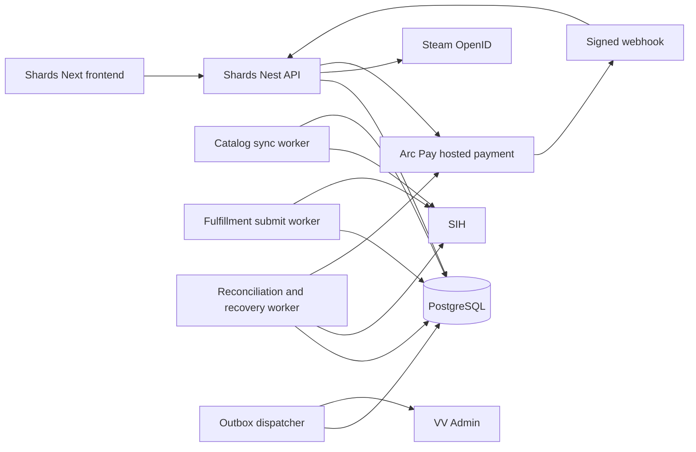

# Shards System Design

Статус: предложено для реализации. Дата исследования: 11 октября 2026 года. Адресат: владелец продукта и разработчик Shards. Область: подключение дизайнерского frontend Shards к самостоятельному production backend на основе проверенных механизмов Frags.

Исследованы актуальные локальные исходники. Git HEAD Frags: `d520298cc1b76392b1cb4da79f35bd9a0d9213c2`; Shards: `8d513af5575df4f6b45ebab4c75c2304d1427c88`. Это идентификаторы базовых коммитов, а не утверждение о чистоте рабочих деревьев. Исторические документы не использованы как доказательство текущего поведения. Секреты, `.env` и production не читались. Платежи, закупки, миграции и deployment не выполнялись. Упомянутые тесты прочитаны, но не запускались в рамках этого независимого исследования.

## 1 Abstract

Рекомендуется самостоятельный модульный backend Shards с PostgreSQL как источником денежных и операционных состояний. Из Frags переносим подход к Steam OpenID, серверным сессиям, wallet ledger и holds, оплатам Arc Pay, каталогу SIH, durable fulfillment commands и transactional outbox. До активации закупок исправляем переносимые дефекты: новый SIH customId на повторной попытке после неизвестного результата, отсутствие полноценного lease recovery, чтение изменяемых реквизитов и закупочной цены после checkout, недостаточную привязку checkout к версии корзины и котировки.

Визуальная система Shards остаётся исходной. Скины оплачиваются только балансом Shards. Steam refill проходит отдельным прямым RUB платежом и не создаёт движения внутреннего баланса. Дуэт состоит из любого доступного ножа и любых доступных перчаток; его стоимость равна сумме двух цен, скидки нет. Float удаляется из модели приложения, API, фильтров и пользовательского интерфейса.

Минимальная корзина — серверная после Steam-входа. Гостю разрешён просмотр и выбор; намерение добавить один предмет или пару сохраняется только для текущей вкладки на время входа. Отдельной постоянной гостевой корзины и сложной синхронизации в первой версии не требуется. Обычная корзина состоит из уникальных SKU с количеством один. Дуэт добавляет две обычные строки одной транзакцией и не становится скидочным bundle.

## 2 Goals and Non Goals

Обязательные результаты:

- Steam identity подтверждена сервером; кошелёк, заказ и trade URL принадлежат одной identity.
- Одно принятие команды создаёт не больше одного заказа, hold, зачисления или внешней финансовой операции.
- Общая стоимость покупки фиксируется сервером, пользователь подтверждает её до hold.
- Неизвестный результат внешнего запроса не выдаётся за отказ и не вызывает новую покупку с новым ключом.
- Каждый hold имеет объяснимое состояние и путь восстановления; остаток не теряется при падении worker.
- Каталог, карточки, дуэт, корзина, два пополнения и кабинет сохраняют композицию, изображения, движение и responsive поведение Shards.

В первую версию не входят multi-provider routing, микросервисы, продажа/вывод скинов, Apple cards, другие игры, скидочные Frags bundles, кредитование кошелька, мультивалютный checkout, точный float конкретного asset и автоматическое обещание полной атомарности двух внешних Steam trades. Персональные подборки и локальное избранное возможны без финансовых обязательств, но не являются условием активации платежей.

## 3 Background and Problem Statement

Shards сейчас является прототипом интерфейса. `ShopProvider` хранит cart, preview-login и trade URL в localStorage; login меняет локальный флаг. Данные товаров приходят из локального каталога. Покупка и пополнение корректно закрыты через ошибки без имитации успеха. Это хороший визуальный исходник, но такой identity и cart нельзя считать состоянием клиента на backend. Источники: [shop-provider.tsx](/Users/anton/Finext/shardsmarket/frontend/src/components/shop-provider.tsx:27), [integrations.ts](/Users/anton/Finext/shardsmarket/frontend/src/lib/integrations.ts:1).

Текущий дуэт уже выбирает произвольные категории `knife` и `gloves`, принимает RUB бюджет и вызывает `addMany(pair)`. Его алгоритм полностью отличается от Frags. Во Frags `mono`, `chroma`, `metal` — фиксированные группы из трёх имён; backend проверяет именно эти имена и распределяет скидку 5% по строкам. Перенос этого модуля под новым названием породит неверный продукт. Источники: [duo-builder.tsx](/Users/anton/Finext/shardsmarket/frontend/src/components/duo-builder.tsx:12), [bundles.service.ts](/Users/anton/Finext/frags/backend/src/modules/bundles/bundles.service.ts:6), [bundle discount](/Users/anton/Finext/frags/backend/src/modules/bundles/bundles.service.ts:40).

В Shards `Product.float` является частью типа, `float` используется сортировкой и виден в корзине. Удаление поля только из карточки недостаточно. Нужно удалить данные fixtures, вывод в сравнении/инспекции, сортировку, URL query mappings и проверки. Состояние износа FN/MW/FT/WW/BS можно сохранить: это отдельная категория товара и часть market hash name, а не точное float. Источники: [types.ts](/Users/anton/Finext/shardsmarket/frontend/src/lib/types.ts:4), [filters.ts](/Users/anton/Finext/shardsmarket/frontend/src/lib/filters.ts:27), [cart-view.tsx](/Users/anton/Finext/shardsmarket/frontend/src/components/cart-view.tsx:19).

Критические различия денежных контрактов: Shards задаёт 1 RUB = 1,6 Shards и half-up; Frags top-up использует 150:100, supplier pricing использует последовательные ceil, SQL каталога содержит собственную копию расчёта. Нельзя изменить только название валюты или одну константу. Источники: [Shards money](/Users/anton/Finext/shardsmarket/frontend/src/lib/money.ts:16), [Frags payment rate](/Users/anton/Finext/frags/backend/src/modules/payments/payments.service.ts:24), [Frags pricing](/Users/anton/Finext/frags/backend/src/modules/catalog/catalog-pricing.service.ts:69), [SQL pricing](/Users/anton/Finext/frags/backend/src/modules/catalog/catalog.service.ts:59).

## 4 Proposed Architecture



| Компонент | Ответственность | Отказ |
| --- | --- | --- |
| Frontend | Отрисовка неизменного дизайна, API data adapter, feedback, pending operation recovery | Сохраняет intent/key; не объявляет timeout отказом |
| API | Auth, owned resources, catalog query, quote, cart mutation, transactional checkout | Fail closed для денежных операций |
| PostgreSQL | Ledger, holds, quote snapshots, cart versions, order lines, commands, payment events, outbox | Без успешного commit нет принятой команды |
| Redis | Кэш, rate limits и транспорт там, где нужен существующим модулям | Не содержит единственную копию заказа или финансового события |
| Catalog worker | SIH listing sync, freshness, metadata mapping, price revision | Старый каталог можно просматривать, устаревший quote нельзя покупать |
| Fulfillment | Предварительная проверка, durable operation, submit, lookup, terminal settlement | Unknown outcome сохраняет hold и прежний operation key |
| Payment reconciliation | Восстановление зависших hosted sessions и пропущенных callback | Тот же authoritative settlement path, что у webhook |
| Outbox | Доставка событий в VV Admin и уведомления | At-least-once, stable event ID, retry и lease recovery |

Нужен самостоятельный стек Shards: отдельные DB, Redis namespace, домен, cookies, source ID VV Admin, секреты и deployment target. Frags остаётся read-only донором исходников. Файлы deployment нельзя копировать как готовую конфигурацию: существующий compose содержит имя Frags и абсолютные `/opt/frags/...` volumes. Источник: [compose.yml](/Users/anton/Finext/frags/compose.yml:1).

В API используется один публичный origin с reverse proxy `/api` и явными auth callback routes. Это уменьшает сложность cross-site cookies. У Frags cookie Secure/HttpOnly, но session SameSite=None; для собственного same-origin Shards предпочтителен Lax при сохранении CSRF guard, точных origin checks и корректного OpenID callback. Источник: [session-cookies.ts](/Users/anton/Finext/frags/backend/src/modules/sessions/session-cookies.ts:32).

## 5 Request Lifecycle and Data Flow

### Вход и получатель

Backend создаёт одноразовый auth attempt с коротким TTL, state и browser token; проверяет OpenID assertion, endpoint, nonce и return_to; поглощает attempt; создаёт или ротирует серверную сессию. Клиент не передаёт доверенный userId. Frags содержит основу этой цепочки, включая database-backed attempts. In-memory fallback не разрешается в production Shards. Источник: [auth.service.ts](/Users/anton/Finext/frags/backend/src/modules/auth/auth.service.ts:69).

Trade URL принимается только через server endpoint. HTTPS host/path и параметры проверяются, partner должен совпасть с account ID из подтверждённого SteamID64. Credential хранится зашифрованным; UI получает только configured/ masked status. На checkout сохраняется immutable encrypted recipient snapshot с key version, partner, SteamID64 и token; worker не использует изменённый после покупки профиль. Frags уже проверяет ownership в parser, но worker получает актуальный credential отдельно от snapshot. Источники: [steam-trade-url.ts](/Users/anton/Finext/frags/backend/src/modules/users/steam-trade-url.ts:17), [users.controller.ts](/Users/anton/Finext/frags/backend/src/modules/users/users.controller.ts:16), [fulfillment.service.ts](/Users/anton/Finext/frags/backend/src/modules/fulfillment/fulfillment.service.ts:222).

### Каталог и деньги

Canonical сумма покупателя — целые Shards minor, scale=2. API возвращает значение, а не локализованную строку в качестве контракта. Преобразование RUB reference задаётся рационально: `rubToShards(R) = floor((8R + 2)/5)`; `shardsToRubReference(S) = floor((5S + 4)/8)`. Все промежуточные вычисления BigInt/SQL numeric, границы проверяются до преобразования в JSON safe integer. Float arithmetic не используется для расчётов денег.

Дуэт и корзина суммируют цены строк в Shards и один раз конвертируют итог в RUB reference. Это сохраняет существующую семантику и явную подпись Shards «Рублёвый итог рассчитан по общей сумме Shards». Независимое округление RUB каждой строки и последующее суммирование не должно подменять RUB reference общего итога. Источники: [sumPrices](/Users/anton/Finext/shardsmarket/frontend/src/lib/money.ts:29), [cart total](/Users/anton/Finext/shardsmarket/frontend/src/components/cart-view.tsx:19).

Supplier pricing хранит исходную цену microUSD, текущую версию FX, markup, версии курса Shards и округления. Курс 8:5 применяется к сохранённой RUB коммерческой стоимости, а не к старому Frags coin amount. Так изменение внутреннего номинала не становится скрытым повышением RUB цены. Предлагаемый начальный markup — 25% как configurable migration default, поскольку он явно установлен последней Frags migration; новый актуальный FX нужен до live запуска. Значения из старой конфигурации не подтверждают актуальный курс. Источник: [0027_frags_sih_markup_25.sql](/Users/anton/Finext/frags/backend/drizzle/migrations/0027_frags_sih_markup_25.sql:9).

Quote должен содержать `pricingVersion`, `supplierListingVersion`, `observedAt`, `expiresAt`, `unitPriceShardsMinor` и максимальный разрешённый supplier cost. Предлагаемый начальный quote TTL — 60 секунд, configurable; он ограничивает срок подтверждения, но сам по себе не резервирует товар у SIH. Listing freshness проверяется отдельно. Catalog cache инвалидируется по версии/TTL: Frags activeSettingCache сейчас хранит Promise без TTL, а SQL listing queries самостоятельно выбирают активную настройку; это может расходить фильтр/сортировку и показанную цену после смены pricing. Источники: [pricing cache](/Users/anton/Finext/frags/backend/src/modules/catalog/catalog-pricing.service.ts:103), [catalog live price](/Users/anton/Finext/frags/backend/src/modules/catalog/catalog.service.ts:394).

### Корзина и дуэт

Гостевой add сохраняет tab-scoped intent `{kind, slugs, intentId, createdAt}`; затем открывается настоящий Steam login. После входа повторяется именно это намерение с тем же key, без цены и userId от клиента. Отказ/отмена входа не создаёт серверную корзину. Исторические `shards:preview-login`, `prism:*` и локальный trade URL не становятся реальными учётными данными. У intent короткий TTL и проверка текущей identity; при смене пользователя требуется новое явное действие.

`addPair` проверяет два различных SKU, категория первого — knife, второго — gloves; оба CS2, enabled, purchasable. В одной транзакции блокируется активная корзина, проверяется её версия, добавляются недостающие строки, увеличивается version. Повтор не создаёт дубликаты. Если один SKU уже присутствует, вставляется только недостающий; если проверка любого участника не прошла, новые строки не добавляются. UI всегда показывает обе актуальные строки после успеха. Бюджет RUB — условие конкретного pair intent, не платёж и не постоянное ограничение последующей корзины. Quote add-pair может вернуть `withinBudget`, `remainingRubMinor` и отказ `BUDGET_EXCEEDED`.

Пара не требует таблицы bundle или скидочной логики. Удалить одну строку из корзины можно независимо. Получение пары не обещает две одновременные Steam передачи: UI и история честно показывают строковые статусы и частичное исполнение. Сохранить подтверждение добавления внизу, ссылку на корзину и aria-live, в том числе внутри quick-view dialog.

### Checkout и hold

1. Создать authoritative quote для `cartId + cartVersion`, подтвердить состав, общий total и получателя. Quote включает hash состава, immutable price snapshots и delivery snapshot/version.
2. Клиент отправляет только `quoteId`, `cartVersion`, `acceptedTotalShardsMinor` и Idempotency-Key.
3. Сначала проверить существующий результат по `(userId, operation, key)`. При совпадающем request hash вернуть прежний order; при другом payload вернуть conflict, даже если новая сумма больше старой.
4. В одной DB transaction заблокировать cart и wallet в фиксированном порядке; проверить ownership, quote expiry, cart version, recipient version и непросроченную закупочную информацию. Не держать DB lock во время сети SIH.
5. Создать order, order lines, один hold общей суммы, durable commands и outbox. Поглотить quote и очистить именно приобретённую версию корзины в той же transaction. Если данных не хватает, transaction откатывается целиком.
6. Вернуть orderId и состояние `held`. Это подтверждение заказа, не факт доставки.

Frags полезен как основа transaction/ledger, но prepareLines выполняется до transaction, server-cart replay проверяет только сумму, а cart cleanup производится отдельным вызовом контроллера. Для Shards нужна явная quote/cart binding, а не только `acceptedTotal >= currentTotal`. Источники: [checkout preparation](/Users/anton/Finext/frags/backend/src/modules/checkout/checkout.service.ts:246), [replayServerCart](/Users/anton/Finext/frags/backend/src/modules/checkout/checkout.service.ts:369), [cart checkout controller](/Users/anton/Finext/frags/backend/src/modules/checkout/checkout.controller.ts:117).

### Wallet top up и Steam refill

Top-up Shards создаёт отдельную Arc Pay session с неизменными Shards credit amount, RUB payable amount, rate version, purpose и owner. Wallet credit появляется только после серверного подтверждения оплаты с exact binding. Redirect `success` лишь запускает чтение состояния. Проверенная duplicate callback не дублирует зачисление.

Для первой версии выбираем пополнение от 100 до 100000 целых Shards, как лимит количества внутренней валюты во Frags. Консервативная charge формула для заданного S — `ceil(5S/8)`, credit ровно S. Для S кратного 100 ceil и half-up совпадают, поэтому отдельного коммерческого исключения из правила округления не возникает. UI берёт payable из server quote, показывает его до оплаты и отклоняет дробный ввод понятным сообщением. Остаток wallet и цены товаров при этом могут иметь дробные Shards. Источники: [topup validation](/Users/anton/Finext/frags/backend/src/modules/payments/payments.service.ts:200), [Shards balance form](/Users/anton/Finext/shardsmarket/frontend/src/components/topups.tsx:6).

Steam refill получает `steamLogin`, сумму зачисления RUB и подтверждённый email из серверной сессии. Для пользователя без сессии переиспользуется email OTP в существующей стилистике dialog; создание оплаты защищено session+CSRF. Подтверждать владение пополняемым Steam login не требуется: это отдельный получатель, не identity внутреннего wallet. SteamID64 не заменяет login: Shards сейчас просит 17 цифр, Frags SIH передаёт `steamUsername`. Нужно изменить подпись и validation существующего поля, не перестраивая панель. Предварительная проверка логина не означает гарантированное пополнение. Фиксируются principal, fee, total и termsVersion; Arc Pay оплачивает total; после подтверждения создаётся отдельный direct-RUB order и SIH refill command. Никаких wallet credit/hold/debit. Источники: [SteamForm](/Users/anton/Finext/shardsmarket/frontend/src/components/topups.tsx:16), [payments controller](/Users/anton/Finext/frags/backend/src/modules/payments/payments.controller.ts:118), [SIH refill invocation](/Users/anton/Finext/frags/backend/src/modules/fulfillment/fulfillment.service.ts:561).

Если банковская оплата прошла, но Steam refill не выполнен, состояние — `paid + fulfillment_failed/manual_review`, не «деньги не списаны». Возврат оформляется по отдельному подтверждённому платёжному процессу; автоматическое зачисление на Shards не заменяет возврат RUB.

## 6 API and Data Contracts

Ниже предлагаемые публичные контракты Shards. Это проект API, а не утверждение, что routes уже реализованы. DTO публикуются через OpenAPI, frontend types генерируются из той же схемы.

| API | Вход | Результат и проверка |
| --- | --- | --- |
| `GET /api/session` | Cookie | Identity, CSRF token, profile summary; anonymous без mock user |
| `GET /auth/steam/start` | Allowlisted returnTo | Steam redirect и browser-bound attempt |
| `POST /api/auth/email/challenges` | email | OTP challenge с TTL и throttling |
| `POST /api/auth/email/challenges/:id/verify` | code, browser-bound challenge | Verified email session, rotation и single-use |
| `PUT /api/users/me/steam-trade-url` | tradeUrl + CSRF | Ownership checked; configured status, без token в ответе |
| `GET /api/catalog` | q, type, condition, price, sort, cursor/limit | Shards catalog DTO без float; freshness и pricing version |
| `GET /api/catalog/:slug` | slug | Stable SKU, image, wear, availability, price snapshot |
| `GET /api/cart` | Session | cartId, version, items, totalShardsMinor, rubReferenceMinor |
| `PUT /api/cart/items/:slug` | expectedVersion, idempotency key | qty=1, unique cart SKU |
| `POST /api/cart/pair` | knifeSlug, glovesSlug, budgetRubMinor, expectedVersion, key | Atomic pair add, updated cart; no discount |
| `DELETE /api/cart/items/:slug` | expectedVersion | Optimistic conflict при изменении другой вкладкой |
| `POST /api/checkout/quotes` | cartVersion | quoteId, lines, total, recipientVersion, expiresAt |
| `POST /api/checkout` | quoteId, cartVersion, acceptedTotalShardsMinor, key | Один order и hold; replay старого результата |
| `POST /api/payments/top-up/quotes` | shardsAmountMinor | RUB payable, credited Shards, termsVersion, expiresAt |
| `POST /api/payments/top-up/sessions` | quoteId, acceptedFiatMinor, key | hosted URL либо pending/review state |
| `POST /api/payments/steam-refill/quotes` | steamLogin, amountRubMinor, session | Verified email из session; recipient check, principal, fee, total, limits |
| `POST /api/payments/steam-refill/sessions` | quoteId, acceptedFiatMinor, key | Direct RUB payment, wallet не участвует |
| `GET /api/orders/:id` | Owner session | Статусы всех строк, Shards reserved/charged/released |
| `GET /api/payments/:id` | Owner session | Server-confirmed payment и fulfillment status |

Для direct Steam выбираем verified email session вместо отдельного capability-протокола. Публичный идентификатор заказа сам по себе не является доступом. Frags создаёт email user в unauthenticated Steam refill route, а `findOrCreateEmailUser` выставляет `verified_at` без OTP. Это ложная маркировка подтверждения email; выдача чужой сессии данным кодом не доказана. Такой путь в Shards не переносится. Вместо него переиспользуются OTP challenge/verify, с отдельными anti-abuse, browser binding и ownership tests. Источники: [createSteamRefillSession](/Users/anton/Finext/frags/backend/src/modules/payments/payments.controller.ts:126), [false verification](/Users/anton/Finext/frags/backend/src/modules/users/users.service.ts:180), [email auth controller](/Users/anton/Finext/frags/backend/src/modules/email-auth/email-auth.controller.ts:13).

Внутренний wallet, его пополнение и skin cart доступны только Steam identity. Email-only identity обслуживает direct Steam и историю её платежей. Steam login сам по себе не сливает email-account с существующим Steam-account и не перемещает средства. Linking разных identities, особенно существующих accounts, требует отдельного доказательства владения и audit flow; это отложено. При смене identity frontend сбрасывает предыдущие user-scoped query caches и не воспроизводит чужой pending intent.

Минимальные durable модели:

| Сущность | Поля сверх обычного id и timestamps | Инвариант |
| --- | --- | --- |
| pricing_version | rate numerator=8, denominator=5, markup, FX snapshot, rounding policy | Использованная версия immutable |
| supplier_listing | provider, game, marketHashName, costMicroUsd, availableQty, observedAt, revision | UI availability не является резервом |
| cart | userId, version | Один active cart на owner |
| cart_item | cartId, productId, rowVersion | UNIQUE(cartId, productId), quantity=1 |
| checkout_quote | owner, cartId/version, recipientVersion, total, lineSnapshots, expiresAt, consumedOrderId | Цена и состав привязаны к одному подтверждению |
| order_line | immutable SKU snapshot, priceShardsMinor, supplier cost cap, encrypted recipient snapshot, status | Не зависит от изменяемого catalog/user после commit |
| wallet_transaction и ledger_entries | idempotencyKey, owner, balanced entries, business reference | Сумма проводок transaction=0 |
| wallet_hold | orderId, amount, captured, released, status | Available=posted-active holds, один hold на order |
| provider_operation | commandId, stable customId, requestHash, immutable request, status | Один business effect, много network attempts |
| provider_attempt | operationId, request/response redacted, transport outcome | Audit trail, не business idempotency key |
| fulfillment_command | dueAt, leaseUntil, leaseToken, attempt count, status | Claim через lease/fencing, crash recovery |
| payment_session | purpose, owner/capability, expected provider IDs, amounts, termsVersion, status | Невозможна перепривязка оплаченной session |
| payment_event | provider event ID, digest, verified attribution, appliedAt | Дубликат не создаёт второй эффект |
| integration_outbox | eventId, aggregateId/version, payload version, lease, attempt count | Событие пишется с бизнес-транзакцией |

На базе Frags можно сохранить внутренние названия `coin_minor` на первом этапе, если единица жёстко определена Shards и публичные DTO не смешивают COINS/Frags/Shards. Массовое переименование SQL таблиц не является условием корректной валюты. Но literal типы rate 150 и currency COINS в API подлежат замене. Источник: [catalog.types.ts](/Users/anton/Finext/frags/backend/src/modules/catalog/catalog.types.ts:49).

## 7 Consistency Idempotency and Replay

### State machines

```text
Skin order: quoted -> held -> processing -> fulfilled | partially_fulfilled | failed
                                  \-> manual_review -> audited resolution
Skin line: held -> preflight -> submitting -> submitted -> sent/protection -> finished
                                  \-> outcome_unknown -> lookup -> submitted | manual_review
Preflight rejection before external effect -> failed -> release corresponding amount
Wallet: posted funds -> active hold -> captured | released | partially_captured
Payment: creation_pending -> checkout_pending -> paid | failed | manual_review
Direct Steam: payment paid -> refill pending -> pay submitted/unknown -> fulfilled | review
```

Terminal transition выполняется compare-and-set с aggregate/version lock. Late `pending` не отменяет `paid/finished`. Chargeback, защита Steam и provider rollback рассматриваются отдельными событиями с аудитом; они не стирают исходную проводку.

Успешный SIH create означает submitted. `sent` и `finished` при ещё processing protection не означают terminal delivery. Frags уже задерживает settlement до завершения protection и удерживает средства при protection failure. Переносим эту семантику. Для пары capture равен сумме подтверждённо завершённых строк; остальное освобождается только после достоверного terminal failure. Неизвестные строки продолжают hold. Источники: [protection transitions](/Users/anton/Finext/frags/backend/src/modules/fulfillment/fulfillment.service.ts:889), [settlement](/Users/anton/Finext/frags/backend/src/modules/fulfillment/fulfillment.service.ts:936).

### Обязательные исправления перед включением закупок

**P0 Stable SIH operation.** Сейчас `customId=attemptId`, новая pending попытка создаёт новый attempt UUID, а сетевой сбой возвращает command в pending. Это допускает вторую покупку после потерянного ответа первой. Создавать stable operation UUID один раз на order line; сохранять до сети; каждый retry/lookup использует прежний key и immutable payload. `timeout`, разрыв соединения после отправки, ошибочный JSON после 2xx и crash после внешнего успеха — `outcome_unknown`. Сначала lookup по тому же customId. Отсутствие объекта в одном немедленном lookup не доказывает отсутствие операции: нужны контракт provider consistency и bounded backoff. Без подтверждённой возможности безопасного recovery — manual_review, без повторной закупки. Источники: [create call](/Users/anton/Finext/frags/backend/src/modules/fulfillment/fulfillment.service.ts:225), [attempt creation](/Users/anton/Finext/frags/backend/src/modules/fulfillment/fulfillment.service.ts:376), [retry transition](/Users/anton/Finext/frags/backend/src/modules/fulfillment/fulfillment.service.ts:1091), [SIH network classification](/Users/anton/Finext/frags/backend/src/modules/providers/sih/sih.client.ts:254).

**P0 Price and recipient binding.** Worker сейчас читает текущий user SteamID, текущий trade credential и текущий supplier cost. Запрещено закупать дороже snapshot cap или доставлять по обновлённому token без определённой политики. Перед submit проверить наличие, price cap, identity и срок preflight. На изменение cost выше cap — отказ до side effect и release/ requote, не дополнительный debit. Точная выбранная wear/SKU не заменяется «похожим». Источник: [claim query](/Users/anton/Finext/frags/backend/src/modules/fulfillment/fulfillment.service.ts:333).

**P0 Recoverability.** Claim SQL с inner join active listing скрывает pending commands, если listing исчезла. Claim должен выбирать durable command независимо от состояния каталога; preflight получает отсутствие listing как управляемый результат. Lease expiration для `processing` не означает «можно выполнить заново»: recovery сначала исследует persisted operation outcome. Источник: [claim inner join](/Users/anton/Finext/frags/backend/src/modules/fulfillment/fulfillment.service.ts:347).

**P0 Concurrency and fairness.** Reconciliation query оставляет status submitted, ставит locked_at, но не исключает leased rows; второй worker после commit может одновременно взять ту же строку. Нужен lease token и fencing при записи результата. В текущем worker reconcile выполняется только когда нет pending submit, поэтому бесконечный поток новых задач может задерживать settlement. Submit, reconcile, expiry/recovery и payment reconciliation получают независимые квоты/cycles. Источники: [reconcile claim](/Users/anton/Finext/frags/backend/src/modules/fulfillment/fulfillment.service.ts:738), [worker cycle](/Users/anton/Finext/frags/backend/src/fulfillment-worker.ts:63).

**P0 Arc Pay binding and recovery.** Сохраняется текущий сильный шаблон: local payment row + provider attempt commit до внешнего create; стабильный session UUID как externalId/key; ambiguous create переводится в review; lookup/reconciliation использует тот же business identity. Требуется проверить exact связь merchant/account, environment, purpose, provider payment ID, local externalId, currency и amount, а не только подпись/сумму. OR lookup по одному externalId нельзя считать достаточной атрибуцией при противоречащем provider_session_id. Источники: [Arc Pay create](/Users/anton/Finext/frags/backend/src/modules/payments/payments.service.ts:913), [ambiguous creation](/Users/anton/Finext/frags/backend/src/modules/payments/payments.service.ts:933), [Steam webhook lookup](/Users/anton/Finext/frags/backend/src/modules/payments/payments.service.ts:1771).

## 8 Security and Privacy Considerations

Сессия HttpOnly/Secure, session token digest в DB, CSRF на всех authenticated mutations, same-origin routing, запрет доверять browser userId/price/balance. Steam auth attempt single-use и browser-bound, ограниченные redirect paths. Отдельные лимиты запросов на auth, payment creation, login checks и expensive catalog filters.

Trade token и исходный trade URL не возвращаются в каталог/историю, не отправляются в VV Admin/analytics и не логируются. Snapshot шифруется с key version; ключи хранятся отдельно от DB. Логи используют operation/order IDs и redacted provider error codes. Customer identity и backend service credentials не копируются из Frags. Production bootstrap прекращается без DB и необходимых signing/encryption keys; fake providers допускаются только в изолированном тестовом окружении.

Для refund/manual resolution доступны только audit commands с RBAC и отдельным idempotency key; нельзя редактировать ledger balance произвольным SQL из интерфейса. Retention для recipient snapshot, provider payloads и audit задаётся отдельной политикой до live; runtime cleanup не уничтожает доказательства незавершённого заказа. Legal тексты и контакты — Shards, без чужих Frags реквизитов.

## 9 Operational Readiness

Миграции Shards строятся для собственной пустой DB из минимального schema baseline плюс additive migrations для quotes, stable operations и leases. Не запускать историю Frags в новой DB вслепую: в ней Apple seeds, старые бренды, fixed bundles и старые pricing defaults. Не переписывать Frags migrations; собственная история Shards тестируется и на пустой DB, и с snapshot предыдущей версии Shards. На rollout сначала backup/restore rehearsal, schema expand, совместимые API/workers, затем activation flags; destructive cleanup после периода совместимости.

Во Frags compose catalog worker спрятан под profile `catalog`, другие workers перечислены отдельными сервисами. API health alone не доказывает, что каталог обновляется, покупка доставляется или VV Admin принимает события. Для Shards нужны явные worker manifests и readiness/heartbeat по функциям. Источник: [compose workers](/Users/anton/Finext/frags/compose.yml:64).

| Сигнал | Начальный launch gate | Ответственный контур |
| --- | --- | --- |
| Ledger imbalance, duplicate business operation | Всегда 0; немедленно закрыть новые финансовые операции | Backend/operations |
| Terminal order с active hold | Всегда 0 после допустимого settlement lag | Wallet reconciliation |
| Processing без lease/recovery owner | Всегда 0; recovery после lease expiry | Worker operations |
| Unknown outcome age | Наблюдается с момента возникновения, review после ограниченного recovery budget | Provider operations |
| Listing/FX age | Checkout закрывается при превышении configured freshness | Catalog worker |
| Pending oldest age | Alert по конфигурируемому пределу; отдельный сигнал для submit/reconcile | Worker operations |
| Outbox age/dead letters | События воспроизводимы, нет silent loss | VV Admin dispatcher |
| Payment paid без fulfillment command | Всегда 0 после commit | Payments reconciliation |
| Readiness | DB schema version, DB connectivity, необходимые workers/config | Release owner |

Численные SLO по throughput/latency нельзя честно вывести из исходников без измерений и нагрузки. До релиза зафиксировать baseline на staging. Launch gate по финансовой целостности абсолютный, а не процент успешных HTTP.

VV Admin получает новый source `shards`, версионированные событийные payloads и стабильный eventId. В событиях различаются order created, held, submitted, fulfilled/partially fulfilled, failed, manual review, payment paid, Steam refill completed. Transactional outbox пишется вместе с бизнес-состоянием. Dispatcher использует lease recovery и at-least-once; VV consumer должен дедуплицировать eventId и учитывать aggregateVersion. Текущий Frags outbox имеет `pending -> processing`; если процесс упадёт после claim, нужна явная reclaim политика. Источники: [outbox claim](/Users/anton/Finext/frags/backend/src/modules/integration/vv-admin-outbox.service.ts:112), [signed dispatch](/Users/anton/Finext/frags/backend/src/modules/integration/vv-admin-dispatcher.ts:17).

## 10 Alternatives Considered

| Вариант | Решение |
| --- | --- |
| Перенести Frags целиком и переименовать | Отклонён: fixed bundles, 1.5 rate, Apple legacy и unsafe retry не соответствуют Shards |
| Оставить browser cart полноценным источником | Отклонён для MVP: отдельная модель guest sync и конфликтов, не нужна для разрешённого scope |
| Удалить корзину и сделать direct buy | Возможен по разрешению пользователя, но хуже сохраняет готовый визуал и сценарий дуэта |
| Server cart after Steam login | Выбран: минимальные денежные инварианты и переиспользование Frags cart/checkout |
| Сделать дуэт коммерческим bundle | Отклонён: нет скидки и fixed composition, достаточно atomic pair add |
| Гарантировать all-or-nothing Steam delivery | Отклонён без внешней transactional reservation: две независимые операции SIH |
| Автоматически retry каждый HTTP timeout | Отклонён: финансовый side effect мог произойти до потери ответа |
| Разделить систему на микросервисы | Отложено: единая DB transaction облегчает order/hold/command/outbox consistency |

## 11 Open Questions and External Evidence

Следующие пункты не препятствуют написанию безопасного backend с выключенными live providers, но являются условиями активации. Ответы должны быть получены из provider contract и реальной acceptance, не из mock tests:

- Семантика SIH `customId`: uniqueness scope, retention, lookup consistency, поведение repeat create и гарантия отсутствия второй покупки. Пока не подтверждено — unknown outcomes не resend автоматически.
- Steam refill: точный формат login, допустимые страны/валюты, минимумы/максимумы, meaning успешного pay response, lookup/replay для сохранённого transactionId, refund policy.
- Arc Pay merchant credentials, callback origin, exact amount unit, available methods card/SBP, session lookup и refund contract. Нельзя рисовать метод оплаты как рабочий, если hosted provider его не принимает.
- Новый FX источник/период обновления, live markup и лимиты экспозиции. 25% — предлагаемое значение переноса, не подтверждение реальной маржинальности.
- Retention и operator workflow для paid-but-undelivered Steam и protection failures.

Существует явный конфликт прототипа SteamID64 с backend Steam login. Его нужно исправить до интеграции формы. Остальные основные продуктовые решения уже заданы пользователем: wallet-only skins, direct-RUB Steam, no float, duo without discount; повторного согласования этих правил не требуется.

## 12 Decision and Next Steps

| Приоритет и этап | Работы | Условие готовности |
| --- | --- | --- |
| P0 Foundation | Standalone Shards backend, own config/secrets, minimal schema, production fail-closed | Fresh DB migration, typecheck/build, no donor secrets/targets |
| P0 Money and identity | 8:5 shared integer domain, OpenAPI DTO, Steam session/CSRF/ownership | Exact rounding vectors, tamper/replay/ownership tests |
| P0 Catalog and cart | SIH metadata adapter without float, catalog freshness, authenticated cart, atomic pair | Pair all-or-nothing add, unique SKU, two-tab version conflicts |
| P0 Quote and checkout | Durable quotes, cart/recipient binding, immutable snapshots, atomic hold/order/commands/outbox | Concurrency and TOCTOU tests, no partial DB effects |
| P0 Recovery | Stable provider operations, unknown state, leases/fencing, price cap, independent reconciliation | Crash-window suite without duplicate purchase/credit |
| P0 Payments | Arc Pay hosted sessions + exact callback binding + scheduled reconciliation; separate Steam flow | Duplicate/out-of-order/mismatched callback suite; no wallet effects for Steam |
| P0 UI integration | Keep visuals, replace local mock identity/data, remove float and direct card skin option | Desktop/mobile screenshots, keyboard, quick view, reload, errors |
| P0 Operations | Wallet audit, worker metrics, VV Admin manifest/source, backup/restore, disabled-live staging | Worker and outbox evidence, recoverable stuck operations |
| Activation | Real sandbox/read-only provider acceptance, limited live rollout only under explicit production task | Provider evidence distinct from tests/CI/HTTP health |
| Deferred | Guest persistent cart, multiple quantities, microservices, recommendation engine, extra games | Separate demand and acceptance criteria |

### Проверки которые должны остановить релиз при падении

1. Два одновременных checkout одного wallet не перерасходуют available; один key создаёт ровно один order/hold; другой payload под тем же key — conflict.
2. Смена cart/recipient/pricing между quote и commit даёт controlled conflict либо использует доказуемо immutable snapshot; не покупает иной товар по старому согласию.
3. Одновременные addPair/addSingle/remove с одинаковой версией не оставляют непроверенную половину пары; duplicate pair не увеличивает количество.
4. Price rounding boundaries 8:5/5:8, большой safe integer, zero/negative/overflow, RUB budget equality; frontend/TS/SQL дают одинаковые total и sort/filter result.
5. Crash before send, after send before response, after response before DB commit, after claim, after lease expiry. Stable key, no duplicate provider effect; stale worker не overwrites recovery outcome.
6. Missing/disabled listing, supplier price increase, stale catalog, stock exhaustion: command получает контролируемый отказ/ожидание, а не пропадает из worker выборки.
7. One duo line finished, other failed/unknown/protection failed: корректные status и capture/release, unknown не освобождает деньги преждевременно.
8. Forged signature, wrong amount/currency/providerId/externalId/purpose, duplicate callback, pending после paid, paid после timeout/manual_review. Нет лишнего credit/order/refill.
9. Steam payment create/pay retries используют прежнюю операцию/transactionId; прямой Steam не читает и не изменяет Shards wallet даже при ошибке.
10. VV Admin down, process crash после outbox claim и после remote accepted: событие восстанавливается и дедуплицируется, заказ не теряется.
11. Logout/session rotation, stolen чужой order/cart/quote ID, trade URL другого Steam, malicious returnTo, guest email чужого пользователя, CSRF: доступ/мутация отклоняется.
12. Frontend end-to-end: Steam login return, pending add, confirmation → cart → item, duo within/over budget, modal keyboard, reload recovery after uncertain checkout, payment return polling. Отдельно визуально проверить сохранение дизайна и отсутствие float на всех экранах.

Полезные существующие тестовые основы Frags: [checkout integration](/Users/anton/Finext/frags/backend/src/modules/checkout/checkout.integration.spec.ts:91), [cart integration](/Users/anton/Finext/frags/backend/src/modules/cart/cart.integration.spec.ts:87), [fulfillment integration](/Users/anton/Finext/frags/backend/src/modules/fulfillment/fulfillment.integration.spec.ts:339), [protection test](/Users/anton/Finext/frags/backend/src/modules/fulfillment/fulfillment.integration.spec.ts:670), [Steam retry test](/Users/anton/Finext/frags/backend/src/modules/fulfillment/fulfillment.integration.spec.ts:1082). Наличие этих тестов не подтверждает новые Shards invariants и не заменяет запуск на собственной изолированной DB.

## Применение шаблона System Design

Прочитаны `artifact-template-system-design/SKILL.md`, `artifact-template.json`, retained `assets/reference.docx` read-only и documents skill с template-distill/template-create. Структура исследования следует двенадцати разделам retained System Design template. Исходный DOCX не изменён.

Полноценное воспроизведение DOCX не выполнено: documents требует авторитетный runtime через workspace dependency loader и bundled LibreOffice; такой loader отсутствует среди доступных tools и в найденных локальных файлах. Системные Python/Node и установленный desktop LibreOffice не использовались как обход. DOCX не создавался, render → inspect PNG не выполнен; визуальная проверка документа не заявляется. Этот Markdown — содержательный исследовательский артефакт, а не имитация проверенного шаблонного Word документа.
